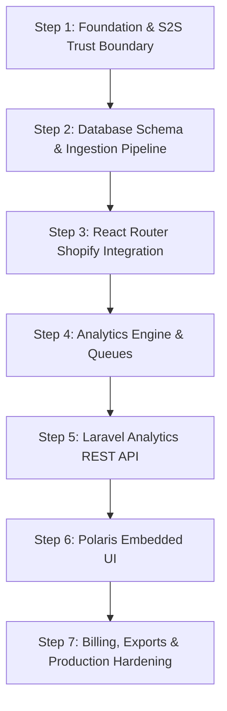

# AGENTS.md — Agent Instructions for Shopify Product Analytics

`shopify-product-analytics` is an embedded Shopify application delivering product-level sales reporting, variant analytics, and performance insights for Shopify merchants inside Shopify Admin.

This document guides coding agents working on this codebase. It defines the binding engineering constraints, architectural boundaries, delivery roadmap, and verification protocols.

---

## 1. Core Binding Constraints

These constraints override convenience. When two rules conflict, security, data integrity, and architectural clarity always win.

### C1. No Guessed Code (Strict)
Every Shopify GraphQL query, mutation, field, webhook topic, payload structure, and API version MUST be verified directly from official Shopify documentation (`shopify.dev/docs/`).
- Never write API fields or mutations from memory.
- Every Laravel model, migration, request validator, and service class must be verified against actual installed framework source code or official Laravel documentation.
- Cite the verified documentation URL or source `file:line` in task summaries, PR descriptions, and commit notes. Never include citations in production code comments.

### C2. Strict Architectural Trust Boundary
The application maintains an absolute separation between two distinct systems:
- **Shopify Integration Layer (React Router):** Exclusively owns Shopify OAuth, session storage, App Bridge embedded UI, Shopify GraphQL Admin API calls, webhook endpoints, and Shopify Billing mutations. Shopify access tokens must NEVER leak to browser code or be transmitted to Laravel.
- **Data & Analytics Engine (Laravel REST API):** Exclusively owns the multi-tenant PostgreSQL database, Redis queues, background aggregation jobs, and analytics REST endpoints. Laravel NEVER calls Shopify GraphQL directly and NEVER stores Shopify access tokens.
- **Service-to-Service (S2S) Security:** Communication from React Router to Laravel (`/internal/v1/*`) MUST be authenticated via HMAC-SHA256 request signing, timestamp verification (replay protection within 300 seconds), and explicit shop context. Untrusted client headers must never dictate tenant identity.

### C3. No AI Attributions
Never include mentions of AI, LLMs, Gemini, Claude, Antigravity, or model names in commit messages, PR descriptions, code comments, or documentation.

### C4. Deep Database & Console Verification
When writing or changing code in any phase:
- Execute exhaustive debugging in the terminal and inspect runtime logs.
- Perform direct database inspection (`psql`, Redis CLI) before considering any step complete.
- Verify migrations apply and roll back cleanly, indexes are utilized, compound unique constraints prevent duplicate ingestion, and aggregation queries execute sub-50ms without table scans.
- Confirm zero query warnings, zero unhandled exceptions, and zero orphaned records.

### C5. Security, Edge & Corner Case Protocol
- **Tenant Isolation:** Every database query, queue job, and analytics request must be scoped strictly by `shop_id`.
- **Financial Precision:** All monetary amounts must be stored as `DECIMAL(20,6)` or integer minor units (cents). Floating-point arithmetic (`float`, `double`) is strictly forbidden for money.
- **Currency Isolation:** Always store amounts with their ISO 4217 currency code. Never sum amounts across different currencies.
- **Timestamp Precision & Half-Open Day Boundaries:** Timestamps (`processed_at`, `refunded_at`) must be stored in PostgreSQL with microsecond precision (`timestamptz(6)`). All daily metric aggregations and analytics queries MUST use half-open intervals $[startOfDayUtc, startOfNextDayUtc)$ (`>= startOfDayUtc` and `< startOfNextDayUtc`). Closed intervals (`<= endOfDay`) or `23:59:59` are strictly prohibited to prevent data loss or double-counting at boundary microseconds.
- **Update Recalculation Buckets:** When orders or refunds are updated, edited, or cancelled, pre-update and post-update state must be captured. Ingestion pipelines must dispatch recalculation jobs for both the previous `(product_id, metric_date)` and the updated `(product_id, metric_date)` buckets so daily aggregate tables are never stale.
- **Multi-Currency Bucket Staleness Elimination:** When recalculating metrics for affected `(shop_id, product_id, metric_date)` buckets, jobs must query all historical currencies currently present in `product_daily_metrics`. If currency modifications, cancellations, or edits remove transactions in a previously recorded currency, the stale currency row must be explicitly zeroed out so foreign currency amounts never linger.
- **Refund Freshness Guards & Monotonicity:** Track `shopify_updated_at` (falling back monotonically to `processed_at`) on `refund_line_items`. Ingestion must enforce conditional updates (`ON CONFLICT DO UPDATE WHERE excluded.shopify_updated_at >= refund_line_items.shopify_updated_at`) and reject stale out-of-order deliveries (`written = 0, skipped_stale = 1`), suppressing outbox events and recalculation triggers.
- **Deterministic Parent Row Locking Under Concurrency:** Ingestion pipelines writing or updating child records (order line items, refund line items) must acquire deterministic row locks (`ORDER BY id ASC lockForUpdate()`) on existing parent orders within `DB::transaction(fn() => ..., 5)` to eliminate deadlocks and race conditions during concurrent webhook ingestion.
- **Protected Customer Data (PCD):** Strictly avoid collecting or storing customer personal data (names, email addresses, phone numbers, shipping addresses) in the database.
- **Webhook Idempotency:** Webhook handlers must verify `X-Shopify-Hmac-Sha256`, deduplicate deliveries using the Shopify webhook ID against `webhook_events`, respond with `200 OK` within 2 seconds, and delegate processing to background queues.

### C6. Probe, Don't Reason
An edge case, formula, or assumption is only considered verified when executed:
- Via automated unit and integration tests, or
- Via a live runtime probe with synthetic payloads.
- Always verify edge scenarios: store timezone day boundaries, leap years, negative net sales from refunds, zero previous periods, and partial line cancellations.

### C7. Edge Check Before Completion
Before marking any feature or step complete, execute the specific edge checks:
- Boundary conditions (inclusive start/end dates, timezone offsets).
- Empty states (store installed with zero orders, products with zero sales).
- Ingestion retries (re-running the same batch must result in zero duplicate rows).
- Plan entitlement barriers (free tier requests for growth-tier endpoints must return `403 Forbidden`).

### C8. Git & Workflow Rules
- **Commits Only On Explicit Request:** Never run `git commit` or `git push` on your own initiative. Wait for explicit user authorization.
- **Feature Branch Workflow:** Develop each milestone on a dedicated feature branch cut from `main` (e.g. `foundation`, `ingestion-pipeline`, `analytics-engine`, `polaris-ui`, `billing-exports`).
- **No CI Workflows:** Continuous Integration (CI) configuration files (e.g. `.github/workflows`) are not used; all test suites, linters, and verification checks run in the local Docker environment.

### C9. Laravel Architectural & Engineering Patterns (Core Guide Standards)
The Laravel backend must strictly implement the recurring cross-cutting patterns defined in the *Laravel Core Architecture & Engineering Patterns Guide*:

1. **The Pipeline Pattern (Ingestion & Request Processing):**
   - Multi-step ingestion pipelines (`POST /internal/v1/ingestion/*`) must use `Illuminate\Pipeline\Pipeline` using discrete, testable pipe classes rather than monolithic controller actions or god-services.
   - Example pipeline stages: `[VerifyHmacSignature::class, ResolveShopTenant::class, DeduplicatePayload::class, UpsertNormalizedBatch::class, DispatchMetricAggregation::class]`.
2. **Atomic Locks & Concurrency Control (Strict Redis Primitives):**
   - Aggregation jobs updating `product_daily_metrics` must implement `ShouldBeUniqueUntilProcessing` (dispatch guard) using unique keys `(shop_id:product_id:metric_date)` to prevent duplicate jobs entering queue buffers while allowing fresh jobs to queue if an update arrives during execution.
   - Concurrent worker execution must be guarded with `WithoutOverlapping($this->lockKey())->releaseAfter(10)->expireAfter(120)`. The lock expiration (120s) must strictly exceed the queue worker execution timeout (90s) so locks cannot expire prematurely while a worker is still writing, and `releaseAfter(10)` provides exponential backoff under worker contention.
   - **Strict Lock Caveat:** Distributed atomic locks MUST run exclusively against the Redis cache driver (`Cache::store('redis')->lock(...)`). Never use database or file drivers for concurrency locks as they lack atomic `SETNX` and Lua script execution.
3. **The Retry Pattern & Deadlock Resilience:**
   - Database operations involving batch upserts or aggregations must be wrapped in `DB::transaction(fn() => ..., 5)` to automatically recover from PostgreSQL deadlocks.
   - Queued jobs must define explicit `$tries = 5`, exponential backoff (`public function backoff(): array = [5, 15, 60]`), and `retryUntil()`.
   - Never blindly retry permanent failures (e.g. `ValidationException`, 422 HTTP responses, malformed GIDs). Filter retryable exceptions explicitly.
4. **Rate Limiting & Throttling:**
   - Use Redis-backed `RateLimiter` for S2S ingestion (`Limit::perMinute(...)`).
   - High-throughput queue workers must use `RateLimited('metrics-aggregation')` and `ThrottlesExceptions(5, 120)` to protect database connection pools from starvation during webhook bursts.
5. **Events & Listeners (No Invisible Control Flow):**
   - Core domain business logic must stay explicit in service/pipeline workflows.
   - **Anti-Pattern Prohibition:** Eloquent Model Observers must NEVER silently alter financial calculations or mutate domain data during `saving`/`updating`.
   - Asynchronous side-effects (triggering aggregations, sync status updates) must be dispatched via explicit Domain Events (`OrderIngested`, `RefundIngested`) handled by listeners implementing `ShouldQueue`.
6. **Deferring Work (`defer()` vs Queued Workers):**
   - Ingestion HTTP endpoints must respond with `200 OK` within 200ms.
   - Compute-heavy tasks (aggregating metrics, processing batches, CSV exports) MUST be dispatched to persistent Redis queue workers.
   - The `defer()` helper is reserved exclusively for non-critical in-process tasks (e.g. lightweight sync counter increments, telemetry).
7. **Pragmatic Driver Pattern (Avoid Premature Abstraction):**
   - Do not invent custom managers or driver abstractions for components with a single concrete implementation.
   - Rely on Laravel's core managers (`Storage`, `Queue`, `Cache`). Apply the Driver pattern (`Illuminate\Support\Manager`) only where multiple interchangeable drivers genuinely exist (e.g. `ExportManager` with `CsvExportDriver`).
8. **The Transactional Outbox Pattern (Zero Event Loss & Replay Idempotency):**
   - Ingestion pipelines (`POST /internal/v1/ingestion/*`) and any process triggering asynchronous side-effects must atomically persist domain events to the `outbox_events` table inside the exact same `DB::transaction(fn() => ..., 5)` as the database upsert.
   - A dual-path delivery model guarantees zero event loss:
     1. *Fast-Path:* The HTTP pipeline immediately dispatches the domain event to Redis and marks the outbox event as `PUBLISHED`.
     2. *Recovery Sweeper & Backoff:* If Redis is temporarily unavailable or a process terminates abruptly, the scheduled background command `php artisan outbox:publish --age=30 --limit=100` queries pending records older than 30 seconds and republishes them.
     3. *Exponential Retry Backoff & Poison Pill Isolation:* Retries must use truncated exponential backoff ($2^{\min(\text{attempts}, 6)} \times 5\text{s}$), capped at 5 attempts before marking status `FAILED`. Fatal unrecoverable payload exceptions (e.g., `\InvalidArgumentException`, unresolvable tenant) must immediately transition status to `FAILED` with diagnostics and zero retry delay.
     4. *Dual-Dispatch Crash Replay Idempotency:* Because a process crash between Redis queue dispatch and PostgreSQL outbox commit causes duplicate sweeper deliveries (at-least-once guarantee), all downstream consumers (e.g., `AggregateProductDailyMetricsJob`) must compute pure aggregations from raw database rows and upsert precomputed values, ensuring duplicate dispatches converge to identical totals without double-counting.

### C10. Pragmatic Simplicity & Clean Code Standards (No Over-Engineering)
- **No Over-Engineering or Speculative Abstraction:** Write straightforward, expressive, and developer-friendly code. Never introduce complex design patterns, multi-tier abstractions, or generic wrappers when a direct, readable implementation satisfies the task. Follow YAGNI (You Aren't Gonna Need It) and KISS (Keep It Simple, Stupid).
- **No Long or Verbose Comments:** Code must be self-documenting through precise domain naming. Paragraph-length comments, redundant explanation of obvious logic (`// saves the product`), or architectural essays are strictly prohibited. Concise 1-line docblocks or notes are permitted only for non-obvious business logic, formulas, or Shopify API quirks. Never include AI attributions in comments.
- **Vigilance Against Code Smells:** Proactively avoid and refactor common code smells:
  - *No God Classes:* Keep classes small and single-purpose (SRP).
  - *No Bloated Methods:* Extract procedural routines into small, well-named helper methods.
  - *No Primitive Obsession:* Use dedicated value objects / DTOs for structured domain data (money, date ranges, Shopify GIDs).
  - *No Duplicate Logic:* Co-locate data with operations and eliminate copy-pasted transformation logic.

### C11. Strict Type-Checking & Disciplined OOP (TypeScript & PHP)
- **PHP / Laravel (PHP 8.2+):**
  - Every PHP file MUST begin with `declare(strict_types=1);`.
  - 100% typed properties, method parameters, and explicit return types throughout all classes, services, and closures. Never use untyped or loose signatures.
  - Use PHP 8.1+ Enums for fixed domain states (e.g., `SyncStatus`, `OrderStatus`, `PlanTier`).
  - Use readonly properties and typed Data Transfer Objects (DTOs) for incoming ingestion batches and internal API contracts.
- **TypeScript / React Router:**
  - TypeScript strict mode enabled (`"strict": true` in `tsconfig.json`).
  - Absolute prohibition of the `any` type. Use explicit interfaces, generics, or `unknown` with runtime type narrowing.
  - Strongly type all Shopify GraphQL query responses, React Router loader/action data, component props, and S2S API payloads.
- **Disciplined OOP:** Apply Object-Oriented principles where structure, encapsulation, and domain clarity are needed. Favor composition over deep inheritance hierarchies.

### C12. Performance-First Architecture & Mandatory Performance Testing
- **Performance by Design:**
  - **Zero N+1 Queries:** Always eager-load relationships (`with(...)`) on Eloquent models.
  - **Sub-50ms Dashboard Response Target:** Overview and product analytics queries must hit indexed precomputed aggregates in `product_daily_metrics`. Never perform on-the-fly table scans over raw order line items on live dashboard requests.
  - **Flat Memory Footprint:** Process large batches and CSV exports using chunking and lazy iteration (`lazy()`, `cursor()`) to prevent PHP memory exhaustion.
- **Mandatory Performance Verification on Every Feature:**
  - Every feature must pass performance inspection before completion:
    - Audit executed query counts via query logging (`DB::listen()` or test assertions).
    - Measure execution time against realistic data loads (e.g., batch of 500 line items).
    - Verify index usage via `EXPLAIN ANALYZE` on all new PostgreSQL queries.
    - Confirm zero memory leaks or worker stalls in background queue jobs.

### C13. Testing Philosophy & TDD Protocol (Pest & Playwright)
- **TDD First for Core Logic:** All financial calculations, metric aggregations, ingestion pipelines, S2S security middleware, and REST API endpoints MUST follow strict TDD First:
  1. **Red:** Write a failing Pest test defining the exact scenario, expected database state, or JSON contract.
  2. **Green:** Implement the minimal, clean code required to satisfy the test.
  3. **Refactor:** Optimize queries, eliminate code smells, enforce strict typing, and verify sub-50ms performance.
- **Pest Framework for Backend:** Pest is the standard testing framework for Unit, Domain, Feature, Ingestion, and Contract tests.
- **Real Database Testing:** Never mock database queries when calculating metrics; run Pest tests against real PostgreSQL in Docker using `RefreshDatabase`.
- **Playwright for E2E:** End-to-end testing of the complete merchant journey (App Bridge embedded UI, installation, date filters, reports) is handled via Playwright on a development store.

### C14. Mandatory DTOs for Laravel REST APIs (Strict Data Contracts)
When authoring or consuming any REST API endpoint in Laravel (both private S2S ingestion `/internal/v1/*` and analytics `/api/v1/*`):
- **Always Use Typed DTOs:** Never pass loose associative arrays, raw request payloads (`$request->all()`), or untyped collections into domain services, pipelines, or background queue jobs.
- **FormRequest to DTO Translation:** HTTP requests must be validated using dedicated `FormRequest` classes and immediately mapped into typed, immutable DTOs (e.g. `$request->toDto()`).
- **Immutable & Readonly:** DTOs must be implemented as `readonly class` (PHP 8.2+) with typed constructor property promotion and explicit types on every property.
- **Predictable Factory Methods:** DTOs must provide strict, static factory methods (e.g. `fromRequest(FormRequest $request): self`, `fromArray(array $data): self`).
- **Consistent Response Contracts:** All outbound API responses must pass through typed Laravel API Resource classes or Response DTOs to ensure frontend contracts are guaranteed and internal database attributes are never leaked.

### C15. Incremental Delivery — One File per Step, Explicit Approval (Strict)
The project owner must understand and control every line that enters the codebase. Writing a whole feature in one pass is prohibited.

1. **Plan first, then stop.** Before writing any code for a feature, present the plan: what the feature provides, and the ordered list of files to create or change, each with a one-line purpose. Wait for approval of the plan.
2. **One file per step.** Each step creates or changes exactly one file. A test file is its own step (TDD: the test step comes before the implementation step it drives).
3. **Before writing the file, explain:** the file path, its role in the feature, what it provides, and how it connects to the files already approved.
4. **After writing the file, explain in plain language:** what each part does and why, any decision made, and how it was verified (test run, lint, probe output). Show the important parts of the file.
5. **Stop and ask permission** before the next step. Do not continue until the owner explicitly approves. Silence, or an unrelated reply, is not approval.
6. **Changes to approved files** follow the same rule: one file, explained, then wait.
7. **No hidden work.** No extra files, refactors, renames, or "while I'm here" edits outside the approved step. If something else needs fixing, report it and ask.
8. **Feature documentation.** When a feature is finished, produce a `docs/<feature>.md` explainer in the style of `docs/migrations.md`: what the feature provides, the request/data flow, a file-by-file breakdown, edge cases handled, and verification evidence.

This rule overrides any instruction to "go", "continue", or "implement the feature": those approve the next single step only.

### C16. Mandatory Large Dataset Load & Memory Benchmarks on Feature Completion
Whenever any feature, ingestion pipeline, background queue job, or analytics REST endpoint is developed, modified, or completed, it MUST be subjected to automated load and memory benchmarks before being considered complete:
1. **Max Boundary Batch Ingestion:** Ingest maximum supported batch limits (e.g., 50 orders / 250 line items per S2S payload) and verify sub-second completion without transaction rollbacks, deadlocks, or lock contention.
2. **High-Volume Aggregation & PostgreSQL Index Scans:** Aggregate metrics over large datasets (1,000+ line items) and verify via query logging / `EXPLAIN ANALYZE` that PostgreSQL executes composite index scans (e.g., `orders_shop_processed_idx`, `line_items_order_tenant_fk`) sub-100ms with zero full-table scans.
3. **Natural Cost-Based Index Evaluation (No Planner Overrides):** PostgreSQL query planner evaluation must reflect natural cost estimates without artificial planner flags (`enable_seqscan = OFF`). Test fixtures and benchmarks must seed realistic data distributions (e.g., 50 pending outbox events among 2,000 total events) so PostgreSQL's optimizer naturally selects index scans.
4. **Long-Range Historical Querying & Constant Complexity ($O(1)$ Queries):** Verify that wide-window dashboard queries (e.g., 365 days of historical data) execute sub-50ms with a constant query count ($O(1)$ queries) and zero N+1 database queries. Report multi-sample latency distributions (p50 < 30ms, p95 < 60ms) over multiple runs rather than single-run averages.
5. **Memory Leak Resistance & Engine Heap Measurement:** Benchmark sequential batch executions to confirm engine heap stability delta (< 2MB) using `memory_get_usage(false)` to measure true PHP engine allocations without noise from libc OS page allocator chunking (`memory_get_usage(true)`), ensuring streaming and lazy iteration (`lazy()`, `cursor()`, chunking) prevent memory exhaustion.

---

## 2. Environment & Commands Reference

The project runs in a containerized Docker environment (Colima on macOS). If `docker` cannot reach the daemon: `export DOCKER_HOST=unix://$HOME/.colima/default/docker.sock`.

```bash
# First run: backend image does not bundle dependencies (source is bind-mounted)
docker compose build
docker compose run --rm --no-deps backend composer install
cd shopify-app && npm install && cd ..   # Shopify app dependencies install on the host

# Docker Environment
docker compose up -d                  # Start backend, laravel-worker, postgres (host port 5433), redis
docker compose --profile app up -d --build shopify-app   # Optional: production-style gateway container on :3000
docker compose down                  # Stop all services
docker compose logs -f [service]     # Tail logs for a specific service

# Backend (Laravel)
docker compose exec backend php artisan migrate              # Run database migrations
docker compose exec backend ./vendor/bin/pest                # Run Pest test suite (Unit, Feature, Contract)
docker compose exec backend ./vendor/bin/pest --filter=Name  # Run targeted test
docker compose exec backend php artisan queue:work redis     # Run queue worker manually
docker compose exec backend php artisan outbox:publish       # Sweeper: publish pending outbox events (default: --age=30 --limit=100)

# Shopify App (runs on the host; Node >= 22.12)
cd shopify-app
shopify app dev --config local   # Dev server + tunnel; loads shopify-app/.env via --env-file-if-exists
npm run build                    # Production build (react-router build)
npm run typecheck                # react-router typegen + tsc strict
npm run lint                     # ESLint
npm test                         # node --test "app/**/*.test.ts" (built-in runner, no extra deps)
npm run setup                    # prisma generate + migrate deploy (shopify_sessions)
# Playwright E2E (npx playwright test) is added with the Step 6 UI; not installed yet.

# Live install check: open the app in the dev store, then confirm the shop reached Laravel
docker compose exec postgres psql -U postgres -d shopify_analytics -c "select shop_domain, status from shops"

# Database & Cache Inspection
docker compose exec postgres psql -U postgres -d shopify_analytics  # Laravel data
docker compose exec postgres psql -U postgres -d shopify_sessions   # Gateway sessions (Prisma)
docker compose exec redis redis-cli                                  # Redis CLI
```

### 2.1 Environment Files & Secrets (Binding)

| File | Committed | Read by | Holds |
|---|---|---|---|
| `backend/.env` | No | Every Laravel process (HTTP, worker, CLI, tests) | `APP_KEY`, DB, Redis, `REDIS_PREFIX=spa-database-`, `CACHE_PREFIX=spa-cache-`, `S2S_SHARED_SECRET` |
| `.env` (root) | No | `docker compose` interpolation | `DB_*` for `postgres`; `S2S_SHARED_SECRET`, `SHOPIFY_API_KEY`, `SHOPIFY_API_SECRET`, `SCOPES`, `SHOPIFY_APP_URL` for `shopify-app` |
| `shopify-app/.env` | No | Host dev only: Prisma CLI and `shopify app dev` (`node --env-file-if-exists=.env`) | `DATABASE_URL` (`localhost:5433/shopify_sessions`), `BACKEND_API_URL`, `S2S_SHARED_SECRET` |
| `.env.example`, `backend/.env.example`, `shopify-app/.env.example` | Yes | Humans | Key names only, never secret values |

- Compose MUST NOT inject Laravel env vars into `backend` or `laravel-worker`. `php artisan serve` strips container env from its HTTP workers (`ServeCommand::$passthroughVariables`), so compose env would reach only the worker and split config (different cache prefixes, unshared Redis locks). `backend/.env` is the single Laravel source of truth.
- `S2S_SHARED_SECRET`, `DB_DATABASE`, `DB_USERNAME`, `DB_PASSWORD` must be identical in both files. `S2S_SHARED_SECRET` and the DB password in `shopify-app/.env` must match them too.
- Shopify credentials go only to the Shopify app (Shopify CLI on the host, compose env for the `app` profile container). Never place them in `backend/.env` or any Laravel config.
- `shopify-app/.dockerignore` excludes `.env*` (except `.env.example`), `shopify.app.*.toml`, `.shopify`, and `tests`; images never contain secrets.
- Required compose values use `${VAR:?message}` so a missing secret fails fast. No hard-coded fallback secrets in code or compose.
- Never print secret values in terminal output; inspect lengths, prefixes, or hashes instead.

### 2.2 Shopify App Configuration

- `shopify-app/shopify.app.toml` is the committed template: `client_id` stays `REPLACE_WITH_DEV_DASHBOARD_CLIENT_ID`.
- `shopify-app/shopify.app.local.toml` (gitignored) holds the real `client_id`. Run Shopify CLI with `--config local` or `shopify app config use local`.
- Keep shared fields (name, handle, scopes, webhooks `api_version`) identical in both files.
- Webhooks/Admin API pinned to `2026-10` (verified at `shopify.dev/docs/api/usage/versioning`; accessible until 2027-10-16). Re-verify before bumping.
- Shopify-managed install (`use_legacy_install_flow` omitted = `false`). App names may not contain "Shopify".

### 2.3 Test Environment Isolation

- Pest Feature tests use `RefreshDatabase` on PostgreSQL `shopify_analytics_test`, created by `infrastructure/docker/postgres/initdb/01-create-test-database.sql` on fresh volumes (run it with `psql -f` on existing volumes).
- Tests use Redis DB 2 (default) / DB 3 (cache) with `spa-test-*` prefixes; `phpunit.xml` overrides use `force="true"`.
- `tests/Feature/Infrastructure/TestEnvironmentIsolationTest.php` must stay green; it fails if tests touch SQLite, the dev database, or dev Redis.

### 2.4 S2S Request Contract

```
Headers:   X-App-Shop-Domain, X-App-Timestamp, X-App-Nonce (UUID), X-App-Signature, X-Correlation-ID
Canonical: METHOD\nPATH\nTIMESTAMP\nNONCE\nSHOP_DOMAIN\nsha256_hex(BODY)
Signature: hex(HMAC_SHA256(S2S_SHARED_SECRET, canonical)), compared with hash_equals
Tolerance: abs(now - ts) <= 300 (inclusive, S2S_TOLERANCE_SECONDS)
Nonce:     Cache::store('redis')->add('s2s:nonce:{uuid}', 1, tolerance * 2), claimed only after the signature verifies
Errors:    401 {"error": "..."}
```

Any change to this contract updates `VerifyS2SSignature.php`, `shopify-app/app/lib/backend/backendClient.server.ts`, and both test suites together.

### 2.5 Shopify App Code Layout (Binding)

```
shopify-app/app/
├── routes/      React Router file routes; thin: authenticate or verify, call a feature, return a response
├── lib/         Shared infrastructure with no business rules (backend/ S2S client, shopify/ webhook + GraphQL helpers)
└── features/    One folder per business capability (shop-lifecycle/, later catalog-sync/, order-sync/ …)
```

- `features/*` may import `lib/*`; `lib/*` never imports `features/*`; a feature never imports another feature's internals.
- Tests sit next to their file as `*.test.ts` and run with `npm test`; `.dockerignore` keeps them out of images.
- Server-only modules are named `*.server.ts`. No barrel `index.ts` files; import the real file.
- Template entry points (`shopify.server.ts`, `db.server.ts`, `entry.server.tsx`, `root.tsx`) stay at `app/`.

---

## 3. Step-by-Step Delivery Roadmap

Development must proceed phase-by-phase, ensuring data integrity before building interface layers.



### Step 1: Foundation & S2S Trust Boundary
- Scaffold Docker Compose configuration (`shopify-app`, `backend`, `postgres`, `redis`, `laravel-worker`).
- Scaffold Laravel 13 backend skeleton with PostgreSQL and Redis connections.
- Scaffold React Router Shopify embedded app skeleton using `@shopify/shopify-app-react-router` and `@shopify/polaris`. *(Done: scaffolded from the official React Router app template; UI uses Polaris web components.)*
- Build and test the Service-to-Service (S2S) HMAC-SHA256 authentication middleware in Laravel and client signer in React Router.
- Verify request replay protection (timestamp tolerance ±300 seconds, inclusive) and single-use nonce verification (`X-App-Nonce`, Redis-claimed).

### Step 2: Database Schema & Ingestion Pipeline
- Author PostgreSQL migrations for core tables:
  - `shops`
  - `products`, `product_variants`
  - `orders`, `order_line_items`, `refund_line_items`
  - `product_daily_metrics`
  - `sync_runs`, `webhook_events`, `subscriptions`
- Apply compound unique constraints:
  - `(shop_id, shopify_product_gid)`
  - `(shop_id, shopify_variant_gid)`
  - `(shop_id, shopify_order_gid)`
  - `(shop_id, product_id, metric_date, currency_code)`
- Implement normalized ingestion endpoints in Laravel (`/internal/v1/ingestion/*`).
- Write idempotent upsert services using the **Pipeline Pattern** (`Illuminate\Pipeline\Pipeline`) preserving historical snapshots (`title_snapshot`, `original_unit_price`, `discount_amount`) and wrapping writes in `DB::transaction(fn() => ..., 5)` for deadlock resilience.

### Step 3: React Router Shopify Integration
- Configure Shopify OAuth and session storage with database persistence.
- Implement GraphQL client with cursor-based pagination (`first: 50, after: $cursor`) and rate-limit cost tracking.
- Build historical synchronization harvester for products, variants, orders (60-day window), and refunds.
- Implement normalizer to map Shopify GraphQL responses into normalized ingestion DTOs.
- Register and implement webhook handlers (`orders/create`, `orders/updated`, `refunds/create`, `products/update`, `app/uninstalled`).
- Ensure webhook verification via `X-Shopify-Hmac-Sha256` before forwarding to Laravel.

### Step 4: Analytics Engine & Aggregation Pipeline
- Create background aggregation jobs dispatched to Redis queues upon order/refund ingestion, protected by **Redis Atomic Locks** (`ShouldBeUniqueUntilProcessing` dispatch guard and `WithoutOverlapping(releaseAfter: 10, expireAfter: 120)` worker execution guard).
- Implement store-timezone conversion: timestamps stored in UTC (`timestamptz(6)`) must map accurately to store-local `metric_date` using half-open intervals $[startOfDayUtc, startOfNextDayUtc)$.
- Enforce strict analytics formulas:
  - Gross Sales = $\sum (\text{Quantity} \times \text{Original Unit Price})$
  - Net Sales = $\text{Gross Sales} - \text{Discounts} - \text{Refunds}$
  - Units Sold = $\text{Purchased Units} - \text{Refunded Units}$
- Build period-over-period comparison calculator ($N$ days vs previous equivalent period) with safe zero-division fallbacks.

### Step 5: Laravel Analytics REST API
- Implement tenant-scoped, cached REST endpoints:
  - `GET /api/v1/analytics/overview` (KPIs: Gross Sales, Net Sales, Refunds, Units, Orders)
  - `GET /api/v1/analytics/sales-trend` (Time-series aggregations by day/week/month)
  - `GET /api/v1/products` (Server-paginated, sortable by sales/units, filterable by vendor/type)
  - `GET /api/v1/products/{id}/analytics` (Product detail breakdown and variant metrics)
  - `GET /api/v1/sync/status` (Sync progress, records processed, last updated timestamp)
- Write automated feature tests for every endpoint verifying tenant isolation and output accuracy.

### Step 6: Embedded UI with Shopify Polaris
- Construct the embedded app shell with Shopify App Bridge navigation and title bar.
- Build the Overview Dashboard:
  - Header with sync status and data freshness badge.
  - Date range selector preset component (Today, 7D, 30D, 90D, Custom).
  - KPI metric cards with period-over-period percentage changes.
  - Interactive sales trend chart.
  - Top 5 products ranking widget.
- Build the Product Performance Table:
  - Full-featured Polaris `IndexTable` with sorting, search, vendor filters, and pagination.
- Build Product Detail view:
  - Single-product KPIs, historical trends, and variant-level performance breakdown.
- Implement loading skeletons, empty states, and sync-in-progress alerts.

### Step 7: Billing, Exports & Production Hardening
- Implement Shopify App Billing via GraphQL mutations (`appSubscriptionCreate`).
- Synchronize subscription statuses (`ACTIVE`, `DECLINED`, `CANCELLED`) to Laravel `subscriptions` table.
- Enforce server-side feature gating based on plan tiers (e.g. 30-day vs 90-day historical range, CSV export access).
- Build asynchronous CSV export queue job with secure, temporary download URLs.
- Implement mandatory Shopify privacy webhooks:
  - `customers/data_request`
  - `customers/redact`
  - `shop/redact`
- Execute complete security review and compliance verification before release.

---

## 4. Key Architectural Definitions

| Concept | Implementation Standard |
|---|---|
| **Shopify Session Storage** | Handled strictly in React Router using secure server-side session adapter |
| **Monetary Amounts** | Stored as `DECIMAL(20,6)` with ISO currency code; strictly no float math |
| **Historical Orders** | Default 60-day window per Shopify API policy unless `read_all_orders` is approved |
| **Dashboard Querying** | Always query precomputed `product_daily_metrics`; never query raw order lines live |
| **Webhook Response** | Immediate `200 OK` after HMAC validation; heavy tasks queued in Redis |
| **Timezone Boundary** | Store timestamps in UTC; convert to store timezone before daily bucketing |
| **Transactional Outbox** | Ingestion pipeline writes to `outbox_events` inside `DB::transaction`; dual-path fast-path + sweeper with exponential backoff and replay idempotency |
| **Half-Open Day Boundary** | `[startOfDayUtc, startOfNextDayUtc)` with `timestamptz(6)` microsecond precision; never `<= endOfDay` |
| **Concurrency Lock Hierarchy** | `ShouldBeUniqueUntilProcessing` + `WithoutOverlapping(releaseAfter: 10, expireAfter: 120)` > 90s worker timeout |
| **Parent Row Locking** | Ingestion locks parent orders with `ORDER BY id ASC lockForUpdate()` in `DB::transaction` to prevent race conditions & deadlocks |
| **Refund Freshness Guard** | `shopify_updated_at` conditional update (`WHERE excluded >= existing`); reject stale out-of-order webhooks (`skipped_stale = 1`) |
| **Multi-Currency Staleness** | Clear old currency buckets in `product_daily_metrics` when order edits or cancellations remove transactions in that currency |
| **Benchmark Standards** | Natural cost-based plans without planner flags; engine heap via `memory_get_usage(false)` (< 2MB); p50 < 30ms, p95 < 60ms |
