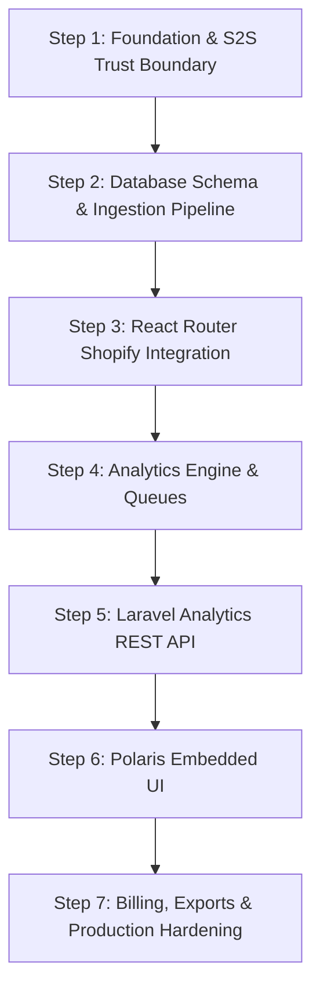

# AGENTS.md — Agent Instructions for Shopify Product Analytics

`shopify-product-analytics` is an embedded Shopify application delivering product-level sales reporting, variant analytics, and performance insights for Shopify merchants inside Shopify Admin.

This document guides coding agents working on this codebase. It defines the binding engineering constraints, architectural boundaries, delivery roadmap, and verification protocols.

---

## 1. Core Binding Constraints

These constraints override convenience. When two rules conflict, security, data integrity, and architectural clarity always win.

### C1. No Guessed Code (Strict)
Every Shopify GraphQL query, mutation, field, webhook topic, payload structure, and API version MUST be verified directly from official Shopify documentation (`shopify.dev/docs/`).
- Never write API fields or mutations from memory.
- Every Laravel model, migration, request validator, and service class must be verified against actual installed framework source code or official Laravel documentation.
- Cite the verified documentation URL or source `file:line` in task summaries, PR descriptions, and commit notes. Never include citations in production code comments.

### C2. Strict Architectural Trust Boundary
The application maintains an absolute separation between two distinct systems:
- **Shopify Integration Layer (React Router):** Exclusively owns Shopify OAuth, session storage, App Bridge embedded UI, Shopify GraphQL Admin API calls, webhook endpoints, and Shopify Billing mutations. Shopify access tokens must NEVER leak to browser code or be transmitted to Laravel.
- **Data & Analytics Engine (Laravel REST API):** Exclusively owns the multi-tenant PostgreSQL database, Redis queues, background aggregation jobs, and analytics REST endpoints. Laravel NEVER calls Shopify GraphQL directly and NEVER stores Shopify access tokens.
- **Service-to-Service (S2S) Security:** Communication from React Router to Laravel (`/internal/v1/*`) MUST be authenticated via HMAC-SHA256 request signing, timestamp verification (replay protection within 300 seconds), and explicit shop context. Untrusted client headers must never dictate tenant identity.

### C3. No AI Attributions
Never include mentions of AI, LLMs, Gemini, Claude, Antigravity, or model names in commit messages, PR descriptions, code comments, or documentation.

### C4. Deep Database & Console Verification
When writing or changing code in any phase:
- Execute exhaustive debugging in the terminal and inspect runtime logs.
- Perform direct database inspection (`psql`, Redis CLI) before considering any step complete.
- Verify migrations apply and roll back cleanly, indexes are utilized, compound unique constraints prevent duplicate ingestion, and aggregation queries execute sub-50ms without table scans.
- Confirm zero query warnings, zero unhandled exceptions, and zero orphaned records.

### C5. Security, Edge & Corner Case Protocol
- **Tenant Isolation:** Every database query, queue job, and analytics request must be scoped strictly by `shop_id`.
- **Financial Precision:** All monetary amounts must be stored as `DECIMAL(20,6)` or integer minor units (cents). Floating-point arithmetic (`float`, `double`) is strictly forbidden for money.
- **Currency Isolation:** Always store amounts with their ISO 4217 currency code. Never sum amounts across different currencies.
- **Protected Customer Data (PCD):** Strictly avoid collecting or storing customer personal data (names, email addresses, phone numbers, shipping addresses) in the database.
- **Webhook Idempotency:** Webhook handlers must verify `X-Shopify-Hmac-Sha256`, deduplicate deliveries using the Shopify webhook ID against `webhook_events`, respond with `200 OK` within 2 seconds, and delegate processing to background queues.

### C6. Probe, Don't Reason
An edge case, formula, or assumption is only considered verified when executed:
- Via automated unit and integration tests, or
- Via a live runtime probe with synthetic payloads.
- Always verify edge scenarios: store timezone day boundaries, leap years, negative net sales from refunds, zero previous periods, and partial line cancellations.

### C7. Edge Check Before Completion
Before marking any feature or step complete, execute the specific edge checks:
- Boundary conditions (inclusive start/end dates, timezone offsets).
- Empty states (store installed with zero orders, products with zero sales).
- Ingestion retries (re-running the same batch must result in zero duplicate rows).
- Plan entitlement barriers (free tier requests for growth-tier endpoints must return `403 Forbidden`).

### C8. Git & Workflow Rules
- **Commits Only On Explicit Request:** Never run `git commit` or `git push` on your own initiative. Wait for explicit user authorization.
- **Feature Branch Workflow:** Develop each milestone on a dedicated feature branch cut from `main` (e.g. `foundation`, `ingestion-pipeline`, `analytics-engine`, `polaris-ui`, `billing-exports`).
- **No CI Workflows:** Continuous Integration (CI) configuration files (e.g. `.github/workflows`) are not used; all test suites, linters, and verification checks run in the local Docker environment.

### C9. Laravel Architectural & Engineering Patterns (Core Guide Standards)
The Laravel backend must strictly implement the recurring cross-cutting patterns defined in the *Laravel Core Architecture & Engineering Patterns Guide*:

1. **The Pipeline Pattern (Ingestion & Request Processing):**
   - Multi-step ingestion pipelines (`POST /internal/v1/ingestion/*`) must use `Illuminate\Pipeline\Pipeline` using discrete, testable pipe classes rather than monolithic controller actions or god-services.
   - Example pipeline stages: `[VerifyHmacSignature::class, ResolveShopTenant::class, DeduplicatePayload::class, UpsertNormalizedBatch::class, DispatchMetricAggregation::class]`.
2. **Atomic Locks & Concurrency Control (Strict Redis Primitives):**
   - Aggregation jobs updating `product_daily_metrics` must implement `ShouldBeUnique` (dispatch guard) using unique keys `(shop_id:product_id:metric_date)` to prevent duplicate jobs entering queue buffers.
   - Concurrent worker execution must be guarded with `WithoutOverlapping($this->lockKey())->expireAfter(60)`.
   - **Strict Lock Caveat:** Distributed atomic locks MUST run exclusively against the Redis cache driver (`Cache::store('redis')->lock(...)`). Never use database or file drivers for concurrency locks as they lack atomic `SETNX` and Lua script execution.
3. **The Retry Pattern & Deadlock Resilience:**
   - Database operations involving batch upserts or aggregations must be wrapped in `DB::transaction(fn() => ..., 5)` to automatically recover from PostgreSQL deadlocks.
   - Queued jobs must define explicit `$tries = 5`, exponential backoff (`public function backoff(): array = [5, 15, 60]`), and `retryUntil()`.
   - Never blindly retry permanent failures (e.g. `ValidationException`, 422 HTTP responses, malformed GIDs). Filter retryable exceptions explicitly.
4. **Rate Limiting & Throttling:**
   - Use Redis-backed `RateLimiter` for S2S ingestion (`Limit::perMinute(...)`).
   - High-throughput queue workers must use `RateLimited('metrics-aggregation')` and `ThrottlesExceptions(5, 120)` to protect database connection pools from starvation during webhook bursts.
5. **Events & Listeners (No Invisible Control Flow):**
   - Core domain business logic must stay explicit in service/pipeline workflows.
   - **Anti-Pattern Prohibition:** Eloquent Model Observers must NEVER silently alter financial calculations or mutate domain data during `saving`/`updating`.
   - Asynchronous side-effects (triggering aggregations, sync status updates) must be dispatched via explicit Domain Events (`OrderIngested`, `RefundIngested`) handled by listeners implementing `ShouldQueue`.
6. **Deferring Work (`defer()` vs Queued Workers):**
   - Ingestion HTTP endpoints must respond with `200 OK` within 200ms.
   - Compute-heavy tasks (aggregating metrics, processing batches, CSV exports) MUST be dispatched to persistent Redis queue workers.
   - The `defer()` helper is reserved exclusively for non-critical in-process tasks (e.g. lightweight sync counter increments, telemetry).
7. **Pragmatic Driver Pattern (Avoid Premature Abstraction):**
   - Do not invent custom managers or driver abstractions for components with a single concrete implementation.
   - Rely on Laravel's core managers (`Storage`, `Queue`, `Cache`). Apply the Driver pattern (`Illuminate\Support\Manager`) only where multiple interchangeable drivers genuinely exist (e.g. `ExportManager` with `CsvExportDriver`).

### C10. Pragmatic Simplicity & Clean Code Standards (No Over-Engineering)
- **No Over-Engineering or Speculative Abstraction:** Write straightforward, expressive, and developer-friendly code. Never introduce complex design patterns, multi-tier abstractions, or generic wrappers when a direct, readable implementation satisfies the task. Follow YAGNI (You Aren't Gonna Need It) and KISS (Keep It Simple, Stupid).
- **No Long or Verbose Comments:** Code must be self-documenting through precise domain naming. Paragraph-length comments, redundant explanation of obvious logic (`// saves the product`), or architectural essays are strictly prohibited. Concise 1-line docblocks or notes are permitted only for non-obvious business logic, formulas, or Shopify API quirks. Never include AI attributions in comments.
- **Vigilance Against Code Smells:** Proactively avoid and refactor common code smells:
  - *No God Classes:* Keep classes small and single-purpose (SRP).
  - *No Bloated Methods:* Extract procedural routines into small, well-named helper methods.
  - *No Primitive Obsession:* Use dedicated value objects / DTOs for structured domain data (money, date ranges, Shopify GIDs).
  - *No Duplicate Logic:* Co-locate data with operations and eliminate copy-pasted transformation logic.

### C11. Strict Type-Checking & Disciplined OOP (TypeScript & PHP)
- **PHP / Laravel (PHP 8.2+):**
  - Every PHP file MUST begin with `declare(strict_types=1);`.
  - 100% typed properties, method parameters, and explicit return types throughout all classes, services, and closures. Never use untyped or loose signatures.
  - Use PHP 8.1+ Enums for fixed domain states (e.g., `SyncStatus`, `OrderStatus`, `PlanTier`).
  - Use readonly properties and typed Data Transfer Objects (DTOs) for incoming ingestion batches and internal API contracts.
- **TypeScript / React Router:**
  - TypeScript strict mode enabled (`"strict": true` in `tsconfig.json`).
  - Absolute prohibition of the `any` type. Use explicit interfaces, generics, or `unknown` with runtime type narrowing.
  - Strongly type all Shopify GraphQL query responses, React Router loader/action data, component props, and S2S API payloads.
- **Disciplined OOP:** Apply Object-Oriented principles where structure, encapsulation, and domain clarity are needed. Favor composition over deep inheritance hierarchies.

### C12. Performance-First Architecture & Mandatory Performance Testing
- **Performance by Design:**
  - **Zero N+1 Queries:** Always eager-load relationships (`with(...)`) on Eloquent models.
  - **Sub-50ms Dashboard Response Target:** Overview and product analytics queries must hit indexed precomputed aggregates in `product_daily_metrics`. Never perform on-the-fly table scans over raw order line items on live dashboard requests.
  - **Flat Memory Footprint:** Process large batches and CSV exports using chunking and lazy iteration (`lazy()`, `cursor()`) to prevent PHP memory exhaustion.
- **Mandatory Performance Verification on Every Feature:**
  - Every feature must pass performance inspection before completion:
    - Audit executed query counts via query logging (`DB::listen()` or test assertions).
    - Measure execution time against realistic data loads (e.g., batch of 500 line items).
    - Verify index usage via `EXPLAIN ANALYZE` on all new PostgreSQL queries.
    - Confirm zero memory leaks or worker stalls in background queue jobs.

### C13. Testing Philosophy & TDD Protocol (Pest & Playwright)
- **TDD First for Core Logic:** All financial calculations, metric aggregations, ingestion pipelines, S2S security middleware, and REST API endpoints MUST follow strict TDD First:
  1. **Red:** Write a failing Pest test defining the exact scenario, expected database state, or JSON contract.
  2. **Green:** Implement the minimal, clean code required to satisfy the test.
  3. **Refactor:** Optimize queries, eliminate code smells, enforce strict typing, and verify sub-50ms performance.
- **Pest Framework for Backend:** Pest is the standard testing framework for Unit, Domain, Feature, Ingestion, and Contract tests.
- **Real Database Testing:** Never mock database queries when calculating metrics; run Pest tests against real PostgreSQL in Docker using `RefreshDatabase`.
- **Playwright for E2E:** End-to-end testing of the complete merchant journey (App Bridge embedded UI, installation, date filters, reports) is handled via Playwright on a development store.

### C14. Mandatory DTOs for Laravel REST APIs (Strict Data Contracts)
When authoring or consuming any REST API endpoint in Laravel (both private S2S ingestion `/internal/v1/*` and analytics `/api/v1/*`):
- **Always Use Typed DTOs:** Never pass loose associative arrays, raw request payloads (`$request->all()`), or untyped collections into domain services, pipelines, or background queue jobs.
- **FormRequest to DTO Translation:** HTTP requests must be validated using dedicated `FormRequest` classes and immediately mapped into typed, immutable DTOs (e.g. `$request->toDto()`).
- **Immutable & Readonly:** DTOs must be implemented as `readonly class` (PHP 8.2+) with typed constructor property promotion and explicit types on every property.
- **Predictable Factory Methods:** DTOs must provide strict, static factory methods (e.g. `fromRequest(FormRequest $request): self`, `fromArray(array $data): self`).
- **Consistent Response Contracts:** All outbound API responses must pass through typed Laravel API Resource classes or Response DTOs to ensure frontend contracts are guaranteed and internal database attributes are never leaked.

---

## 2. Environment & Commands Reference

The project runs in a containerized Docker environment:

```bash
# Docker Environment
docker compose up -d                  # Start all services (React Router, Laravel, Postgres, Redis, Worker)
docker compose down                  # Stop all services
docker compose logs -f [service]     # Tail logs for a specific service

# Backend (Laravel)
docker compose exec backend php artisan migrate              # Run database migrations
docker compose exec backend ./vendor/bin/pest                # Run Pest test suite (Unit, Feature, Contract)
docker compose exec backend ./vendor/bin/pest --filter=Name  # Run targeted test
docker compose exec backend php artisan queue:work redis     # Run queue worker manually

# Shopify App (React Router) & E2E
docker compose exec shopify-app npm run dev                 # Start React Router embedded dev server
docker compose exec shopify-app npm run build               # Build frontend assets
docker compose exec shopify-app npm run lint                # Run TypeScript / ESLint checks
docker compose exec shopify-app npx playwright test          # Run Playwright E2E suite against dev store

# Database & Cache Inspection
docker compose exec postgres psql -U postgres -d shopify_analytics  # PostgreSQL CLI
docker compose exec redis redis-cli                                  # Redis CLI
```

---

## 3. Step-by-Step Delivery Roadmap

Development must proceed phase-by-phase, ensuring data integrity before building interface layers.



### Step 1: Foundation & S2S Trust Boundary
- Scaffold Docker Compose configuration (`shopify-app`, `backend`, `postgres`, `redis`, `laravel-worker`).
- Scaffold Laravel 11/12 backend skeleton with PostgreSQL and Redis connections.
- Scaffold React Router Shopify embedded app skeleton using `@shopify/shopify-app-react-router` and `@shopify/polaris`.
- Build and test the Service-to-Service (S2S) HMAC-SHA256 authentication middleware in Laravel and client signer in React Router.
- Verify request replay protection (timestamp tolerance ±300 seconds) and nonce verification.

### Step 2: Database Schema & Ingestion Pipeline
- Author PostgreSQL migrations for core tables:
  - `shops`
  - `products`, `product_variants`
  - `orders`, `order_line_items`, `refund_line_items`
  - `product_daily_metrics`
  - `sync_runs`, `webhook_events`, `subscriptions`
- Apply compound unique constraints:
  - `(shop_id, shopify_product_gid)`
  - `(shop_id, shopify_variant_gid)`
  - `(shop_id, shopify_order_gid)`
  - `(shop_id, product_id, metric_date, currency_code)`
- Implement normalized ingestion endpoints in Laravel (`/internal/v1/ingestion/*`).
- Write idempotent upsert services using the **Pipeline Pattern** (`Illuminate\Pipeline\Pipeline`) preserving historical snapshots (`title_snapshot`, `original_unit_price`, `discount_amount`) and wrapping writes in `DB::transaction(fn() => ..., 5)` for deadlock resilience.

### Step 3: React Router Shopify Integration
- Configure Shopify OAuth and session storage with database persistence.
- Implement GraphQL client with cursor-based pagination (`first: 50, after: $cursor`) and rate-limit cost tracking.
- Build historical synchronization harvester for products, variants, orders (60-day window), and refunds.
- Implement normalizer to map Shopify GraphQL responses into normalized ingestion DTOs.
- Register and implement webhook handlers (`orders/create`, `orders/updated`, `refunds/create`, `products/update`, `app/uninstalled`).
- Ensure webhook verification via `X-Shopify-Hmac-Sha256` before forwarding to Laravel.

### Step 4: Analytics Engine & Aggregation Pipeline
- Create background aggregation jobs dispatched to Redis queues upon order/refund ingestion, protected by **Redis Atomic Locks** (`ShouldBeUnique` dispatch guard and `WithoutOverlapping` worker execution guard).
- Implement store-timezone conversion: timestamps stored in UTC must map accurately to store-local `metric_date`.
- Enforce strict analytics formulas:
  - Gross Sales = $\sum (\text{Quantity} \times \text{Original Unit Price})$
  - Net Sales = $\text{Gross Sales} - \text{Discounts} - \text{Refunds}$
  - Units Sold = $\text{Purchased Units} - \text{Refunded Units}$
- Build period-over-period comparison calculator ($N$ days vs previous equivalent period) with safe zero-division fallbacks.

### Step 5: Laravel Analytics REST API
- Implement tenant-scoped, cached REST endpoints:
  - `GET /api/v1/analytics/overview` (KPIs: Gross Sales, Net Sales, Refunds, Units, Orders)
  - `GET /api/v1/analytics/sales-trend` (Time-series aggregations by day/week/month)
  - `GET /api/v1/products` (Server-paginated, sortable by sales/units, filterable by vendor/type)
  - `GET /api/v1/products/{id}/analytics` (Product detail breakdown and variant metrics)
  - `GET /api/v1/sync/status` (Sync progress, records processed, last updated timestamp)
- Write automated feature tests for every endpoint verifying tenant isolation and output accuracy.

### Step 6: Embedded UI with Shopify Polaris
- Construct the embedded app shell with Shopify App Bridge navigation and title bar.
- Build the Overview Dashboard:
  - Header with sync status and data freshness badge.
  - Date range selector preset component (Today, 7D, 30D, 90D, Custom).
  - KPI metric cards with period-over-period percentage changes.
  - Interactive sales trend chart.
  - Top 5 products ranking widget.
- Build the Product Performance Table:
  - Full-featured Polaris `IndexTable` with sorting, search, vendor filters, and pagination.
- Build Product Detail view:
  - Single-product KPIs, historical trends, and variant-level performance breakdown.
- Implement loading skeletons, empty states, and sync-in-progress alerts.

### Step 7: Billing, Exports & Production Hardening
- Implement Shopify App Billing via GraphQL mutations (`appSubscriptionCreate`).
- Synchronize subscription statuses (`ACTIVE`, `DECLINED`, `CANCELLED`) to Laravel `subscriptions` table.
- Enforce server-side feature gating based on plan tiers (e.g. 30-day vs 90-day historical range, CSV export access).
- Build asynchronous CSV export queue job with secure, temporary download URLs.
- Implement mandatory Shopify privacy webhooks:
  - `customers/data_request`
  - `customers/redact`
  - `shop/redact`
- Execute complete security review and compliance verification before release.

---

## 4. Key Architectural Definitions

| Concept | Implementation Standard |
|---|---|
| **Shopify Session Storage** | Handled strictly in React Router using secure server-side session adapter |
| **Monetary Amounts** | Stored as `DECIMAL(20,6)` with ISO currency code; strictly no float math |
| **Historical Orders** | Default 60-day window per Shopify API policy unless `read_all_orders` is approved |
| **Dashboard Querying** | Always query precomputed `product_daily_metrics`; never query raw order lines live |
| **Webhook Response** | Immediate `200 OK` after HMAC validation; heavy tasks queued in Redis |
| **Timezone Boundary** | Store timestamps in UTC; convert to store timezone before daily bucketing |
