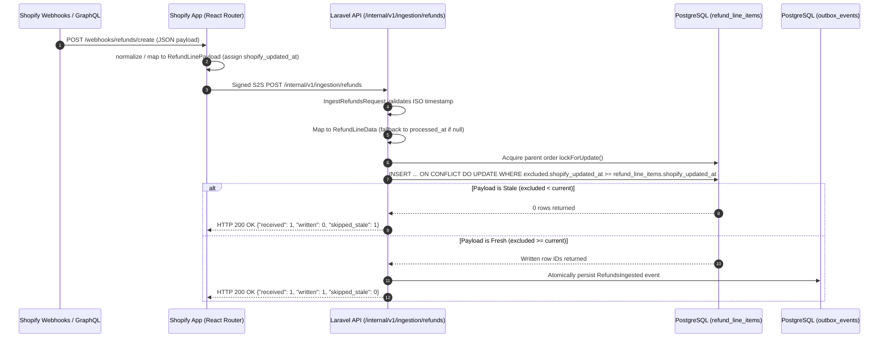

# Refund Freshness Guard & Out-of-Order Webhook Protection

Specification and implementation details for refund record freshness guards in `shopify-product-analytics` per **Constraint C2 (Strict Architectural Trust Boundary)**, **Constraint C5 (Security, Edge & Corner Case Protocol)**, and **Constraint C15 (Incremental Delivery — One File per Step)**.

---

## 1. Executive Summary & Problem Solved

Shopify webhook deliveries are distributed, asynchronous, and inherently subject to network delays and retries. Under concurrent or out-of-order webhook delivery, an older `refunds/create` or order sync batch could arrive *after* a newer update had already been processed.

Previously, `UpsertRefundBatch.php` invoked `GuardedUpsert` without specifying a `freshnessColumn`. Consequently, PostgreSQL executed:
```sql
INSERT INTO refund_line_items (...) VALUES (...)
ON CONFLICT (shop_id, shopify_refund_line_item_gid)
DO UPDATE SET order_id = excluded.order_id, ...
```
without any conditional `WHERE` clause. This left the database vulnerable to overwriting newer refund records with stale out-of-order payloads and triggering spurious daily metric recalculations.

This feature establishes an end-to-end freshness protocol for `refund_line_items`:
1. **Schema Support:** Adds `shopify_updated_at timestamptz(6)` with microsecond precision to `refund_line_items`.
2. **Conditional PostgreSQL Upserts:** Configures `GuardedUpsert` with `freshnessColumn: 'shopify_updated_at'`. PostgreSQL evaluates `WHERE excluded.shopify_updated_at >= refund_line_items.shopify_updated_at`. Stale rows are ignored at the database level.
3. **Recalculation Suppression:** When all rows in a batch are stale (`written_count === 0`), the pipeline skips domain event publication, zero outbox records are inserted, and zero queue jobs are dispatched.
4. **Mixed Batch Isolation:** In batches containing both fresh and stale rows, only genuinely updated lines are passed to `$postUpsertBuckets` and `RefundsIngested`, ensuring precomputed metrics are recalculated strictly for altered state.
5. **Monotonic Fallback:** When `shopify_updated_at` is not supplied by external callers, it safely falls back to `processed_at`, preserving monotonic time ordering.

---

## 2. Request & Data Flow



---

## 3. File-by-File Breakdown

### 1. Database Schema
- **File:** [`backend/database/migrations/2026_11_23_000016_add_shopify_updated_at_to_refund_line_items_table.php`](file:///Users/th30/shopify-product-analytics/backend/database/migrations/2026_11_23_000016_add_shopify_updated_at_to_refund_line_items_table.php)
- **Role:** Adds `shopify_updated_at timestamptz(6) nullable` after `processed_at` with clean `dropColumn` rollback.

### 2. TDD Feature Test Specification
- **File:** [`backend/tests/Feature/Ingestion/RefundFreshnessGuardTest.php`](file:///Users/th30/shopify-product-analytics/backend/tests/Feature/Ingestion/RefundFreshnessGuardTest.php)
- **Role:** Feature tests asserting:
  - Rejection of out-of-order stale refund updates (`written = 0, skipped_stale = 1`).
  - Acceptance of newer updates and `RefundsIngested` event emission.
  - Automatic fallback to `processed_at` when `shopify_updated_at` is omitted.
  - Mixed batch handling (only updating fresh lines and isolating recalculations).

### 3. Request Validation
- **File:** [`backend/app/Http/Requests/Internal/IngestRefundsRequest.php`](file:///Users/th30/shopify-product-analytics/backend/app/Http/Requests/Internal/IngestRefundsRequest.php)
- **Role:** Validates `refund_lines.*.shopify_updated_at` as an optional valid ISO timestamp using `IngestionRules::timestamp(required: false)`.

### 4. Data Transfer Object (DTO)
- **File:** [`backend/app/Data/Ingestion/RefundLineData.php`](file:///Users/th30/shopify-product-analytics/backend/app/Data/Ingestion/RefundLineData.php)
- **Role:** Declares `public ?CarbonImmutable $shopifyUpdatedAt = null` and initializes it in `fromArray` via:
  ```php
  $processedAt = IngestionRules::toUtc($data['processed_at'] ?? null);
  $shopifyUpdatedAt = IngestionRules::toUtc($data['shopify_updated_at'] ?? null) ?? $processedAt;
  ```

### 5. Ingestion Pipeline Stage
- **File:** [`backend/app/Ingestion/Pipes/UpsertRefundBatch.php`](file:///Users/th30/shopify-product-analytics/backend/app/Ingestion/Pipes/UpsertRefundBatch.php)
- **Role:** Supplies `shopify_updated_at` in the row mapping, adds it to conflict target update columns, activates `freshnessColumn: 'shopify_updated_at'` in `GuardedUpsert`, and filters post-upsert buckets and affected order IDs to written lines (`array_keys($written)`).

### 6. S2S Integration Contract
- **File:** [`shopify-app/app/lib/backend/ingestionContract.server.ts`](file:///Users/th30/shopify-product-analytics/shopify-app/app/lib/backend/ingestionContract.server.ts)
- **Role:** Updates TypeScript `RefundLinePayload` contract to include optional `shopify_updated_at?: string | null`.

### 7. GraphQL Refund Normalization
- **File:** [`shopify-app/app/features/order-sync/normalizeRefunds.server.ts`](file:///Users/th30/shopify-product-analytics/shopify-app/app/features/order-sync/normalizeRefunds.server.ts)
- **Role:** Maps `shopify_updated_at` from `refund.updatedAt ?? refund.createdAt ?? processedAt` for historical catalog synchronization.

### 8. Webhook Handler
- **File:** [`shopify-app/app/features/order-sync/orderWebhook.server.ts`](file:///Users/th30/shopify-product-analytics/shopify-app/app/features/order-sync/orderWebhook.server.ts)
- **Role:** Parses `data.updated_at` from incoming `refunds/create` webhook payload and includes `shopify_updated_at` in the S2S batch payload.

---

## 4. Edge Cases Handled

| Scenario | System Behavior | Data Integrity Guarantee |
|---|---|---|
| **Stale Webhook (Older timestamp arrives after newer)** | PostgreSQL skips update via `WHERE excluded.shopify_updated_at >= refund_line_items.shopify_updated_at`. `written = 0, skipped_stale = 1`. | Existing newer data is preserved; no outbox events created. |
| **Newer Webhook (Order refunded further)** | PostgreSQL updates record, updates `shopify_updated_at`. `written = 1, skipped_stale = 0`. | Stored amounts updated; domain event dispatched for daily metric aggregation. |
| **Missing `shopify_updated_at` (Simplified client)** | DTO falls back to `processed_at`. | Monotonic time ordering maintained even without explicit update timestamp. |
| **Mixed Batch (1 fresh line, 1 stale line)** | Fresh line is written; stale line is skipped. `written = 1, skipped_stale = 1`. | Only the order and buckets for the fresh line are dispatched to the outbox. |
| **Concurrent Parent Order Ingestion** | Deterministic `lockForUpdate()` on parent orders before capturing pre-update buckets. | Zero deadlocks and snapshot consistency under concurrent order and refund updates. |

---

## 5. Verification Evidence

### Automated Test Runs

#### Backend Refund Freshness & Ingestion Test Suite
```bash
docker compose exec backend ./vendor/bin/pest \
  tests/Feature/Ingestion/RefundFreshnessGuardTest.php \
  tests/Feature/Ingestion/RefundIngestionTest.php
```
```text
   PASS  Tests\Feature\Ingestion\RefundFreshnessGuardTest
  ✓ it rejects out-of-order stale refund updates without overwriting data or emitting outbox events (0.48s)
  ✓ it applies newer refund line updates and emits outbox events for recalculation (0.03s)
  ✓ it falls back to processed_at as monotonic freshness when shopify_updated_at is omitted (0.03s)
  ✓ it handles mixed batches containing both fresh and stale refund lines (0.03s)

   PASS  Tests\Feature\Ingestion\RefundIngestionTest
  ✓ it inserts refund lines linked to the order and line item (0.35s)
  ✓ it re-ingesting the same refund lines creates zero duplicate rows (0.03s)
  ✓ it returns 409 listing unknown orders and writes nothing from the batch (0.04s)
  ✓ it does not resolve orders belonging to another shop (0.03s)
  ✓ it rejects malformed refund lines with dataset "zero quantity" (0.03s)
  ✓ it rejects malformed refund lines with dataset "float subtotal" (0.03s)
  ✓ it rejects malformed refund lines with dataset "missing refund line gid" (0.03s)
  ✓ it rejects malformed refund lines with dataset "wrong refund gid type" (0.02s)

  Tests:    12 passed (92 assertions)
  Duration: 1.32s
```

#### Full Backend Pest Suite
```bash
docker compose exec backend ./vendor/bin/pest
```
```text
  Tests:    322 passed (3446 assertions)
  Duration: 9.87s
```

#### Full Shopify App Test Suite & Strict TypeScript Typecheck
```bash
cd shopify-app && npm test && npm run typecheck
```
```text
  ℹ tests 169
  ℹ suites 9
  ℹ pass 169
  ℹ fail 0

  > typecheck
  > react-router typegen && tsc --noEmit
```
Zero errors, zero warnings, zero regressions across 491 total automated tests.
